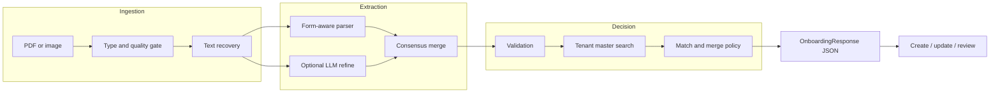
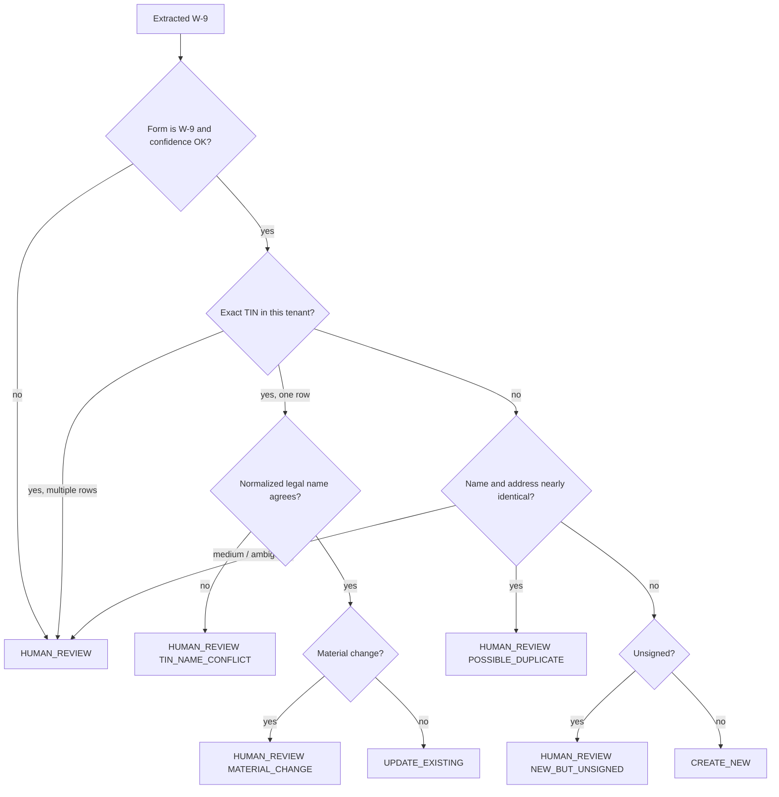

# W-9 Extraction and Supplier Onboarding

PairSoft Central AI Services — technical case study

**Author role:** AI Engineer / AI Architect  
**Prototype version:** 0.1.0  
**API schema:** 1.0  
**Scope:** US W-9 only, designed so country-specific intake can be added later

---

## 1. Problem frame

Supplier onboarding is the front door to AP. A bad supplier record is not a data-quality nuisance; it is duplicate payments, broken spend rollups, failed 1099s, and fraud. The service therefore has one job:

> Take a W-9, produce a trustworthy structured identity, and tell a downstream system whether to **create**, **update**, or **stop and ask a human**.

That last option is not a failure mode. On a P2P platform, human review is a product feature. Auto-creating the wrong supplier is worse than delaying a good one.

### 1.1 What “done” means for the platform

Downstream PairSoft products should be able to call this API without knowing how extraction works. They need:

- extracted fields with per-field confidence
- machine-readable validation flags
- a single match decision with a reason code, not a similarity score they have to interpret
- a stable JSON contract
- an audit trail they can show a customer, an auditor, or a tax team

They do **not** need a model name, a raw OCR dump, or a ranked list of twenty near-matches unless the decision is review.

### 1.2 Assumptions I designed against

I wrote these down first and built to them. If they are wrong, the walkthrough should start here.

1. **Volume is low and uneven.** 10–50 W-9s per customer per week, ~500 customers today. That is 5k–25k documents a week, not a streaming problem. Correctness, tenant isolation, and review quality dominate throughput.
2. **Each customer has its own supplier master.** Hundreds to tens of thousands of rows. Search is available. Cross-tenant learning is forbidden, including “this TIN was good for another customer.”
3. **US suppliers only in v1.** A W-8 is a wrong-form event, not a parse-anyway event. The architecture leaves a `form_family` seam for later country packs.
4. **IRS TIN Matching exists but is not in the prototype.** Format checks are local. Name/TIN IRS match is a production dependency with batch SLAs and should not be faked.
5. **The W-9 arrives dirty.** Phone photos, 2018 layouts, missing signatures, handwritten names, and the occasional W-8. The service must degrade to review, not hallucinate a supplier.
6. **Bank account is on the master, not on the W-9.** Fraud signals that need bank data (same account, many names) are master-side joins, not extraction features.
7. **Downstream already owns create / update / review workflow.** This service returns a decision. It does not write the master.
8. **PII handling is part of the product.** TINs are SSN or EIN. Logs, traces, and eval reports never carry raw TINs.

### 1.3 Non-goals for this exercise

A production API cluster, UI, authn/z, and the human-review console are out of scope. So is exhaustive coverage of every W-9 edge case. I picked the cases that change money movement or tax posture: identity match, material change, TIN/name conflict, unsigned form, wrong form, and near-duplicate names.

---

## 2. End-to-end architecture



In production I would deploy this as a **synchronous API plus an async worker**, not as a single always-on prompt.

- **API** (`POST /v1/onboarding/w9`): accepts the file, tenant id, optional `request_id`, returns 202 with a job id for scans, or 200 with the full `OnboardingResponse` when page count is 1 and the queue is empty. Most W-9s are one page; the happy path should feel like an API, not a batch job.
- **Worker**: OCR / Document Intelligence, LLM structure, validation, master lookup. Idempotent on `(tenant_id, document_sha256)`.
- **Supplier master adapter**: tenant-scoped search. Blocking keys in this order: hashed TIN, normalized legal name, normalized address. The prototype substitutes a CSV because the case study allows it.
- **Review sink**: the response is the contract. A workflow tool can open a task when `decision = HUMAN_REVIEW`.
- **Audit store**: append-only record of redacted fields, flags, decision, model versions, and document hash.

I would **not** put this on a shared “call GPT on every file” function app with no contract. The matching policy has to be deterministic and reviewable. Models extract; rules decide.

### 2.1 Why not a bigger platform

At this volume, Kafka, feature stores, and a custom vector DB are costume jewelry. A queue, a structured store for responses, object storage for source files (customer-managed keys), and a tenant-isolated search API are enough. If the portfolio later reuses the same extraction plane for invoices, the **extraction adapter** is what gets shared, not the W-9 decision table.

---

## 3. Extraction approach

### 3.1 The position

**Primary path in production:** Azure Document Intelligence custom extraction model for W-9 (2018 and 2024 layouts), then a small LLM pass over *recovered text and DI fields* to normalize classification, split city/state/ZIP, and fill gaps.

**Not** LLM-vision as the system of record. **Not** regex-only on real scans.

| Option | Why I would use it | Why I would not use it alone |
|---|---|---|
| Azure DI custom model | Best form-layout prior; checkboxes, signatures, and revisions are first-class; predictable field names | Cold start needs labeled W-9s; weaker at messy handwriting without a second pass |
| AWS Textract Analyze ID / Queries | Fine if the estate is already AWS | Queries are prompty; checkbox + revision handling is weaker than a custom DI model for a known IRS form |
| LLM vision (GPT-4o / Claude) | Excellent on odd photos; fast to prototype | Cost, PII leaving the VPC, non-deterministic field names, harder to audit “why was Line 1 that string?” |
| Classical OCR + regex | Cheap, local, explainable | Breaks on scan quality, 2018 vs 2024, handwriting |
| Human key-from-image | Ground truth for training and review | Not a platform |

The hybrid is the point: DI gives you anchors and a confidence per field. The LLM is a normalizer, not an inventor. If they disagree on TIN or legal name, confidence drops and the document goes to review.

### 3.2 What the prototype actually runs

The case study asked for something a colleague can run without standing up Azure. So the prototype implements the same contract with a local stand-in:

1. **Ingest** a PDF or image. Digital PDFs use the text layer (`pdfplumber`). Images use Tesseract if present; otherwise the document is marked low quality instead of faking OCR.
2. **Detect form family.** `W-9`, `W-8`, or `UNKNOWN`. W-8 short-circuits extraction.
3. **Heuristic form parser.** Label-oriented, W-9 line aware. This is the DI stand-in.
4. **Optional LLM refine.** If `OPENAI_API_KEY` is set, `gpt-4o-mini` reads the recovered text (not the image) and proposes the same schema. Consensus merge boosts or penalizes confidence.
5. **Per-field confidence.** Present and well-formed beats present. Two extractors agreeing beats one.

This is honest about the messy part: a phone-scan of a crumpled 2018 W-9 will not be solved by my regex. Production DI would. The **decision layer and the API contract** are the parts I want judged as platform code.

### 3.3 Confidence

`overall_confidence` is not an LLM self-score. It is a weighted blend of:

- required field confidences (legal name, TIN, address pieces)
- document text-recovery quality
- a penalty when extractors disagree

Downstream should use `overall_confidence` as a gate, and the per-field scores to decide what a reviewer must look at. A 0.95 TIN with a 0.4 street is a different review task than a 0.4 TIN.

---

## 4. Validation and the quality signal

Validation is a separate step from extraction on purpose. Extraction says “I saw this.” Validation says “this is allowed to become a supplier.”

Flags are codes, not prose. Downstream can route on them.

| Code | Severity | Meaning |
|---|---|---|
| `WRONG_FORM` | error | Not a W-9 |
| `MISSING_LEGAL_NAME` | error | Line 1 empty — IRS TIN Matching cannot run |
| `MISSING_TIN` / `TIN_FORMAT_INVALID` | error | Cannot establish tax identity |
| `MISSING_SIGNATURE` | error | Form is not a valid certification |
| `TIN_TYPE_CLASSIFICATION_MISMATCH` | warning | e.g. C-Corp with an SSN |
| `INCOMPLETE_ADDRESS` / `INVALID_STATE` / `INVALID_ZIP` | warning | Pay-to / 1099 address risk |
| `LEGACY_FORM_REVISION` | info | 2018 layout; Line 3b will be absent |
| `LOW_DOCUMENT_QUALITY` | warning | OCR / text layer is thin |
| `EXTRACTOR_DISAGREEMENT` | warning | Heuristic and LLM fought |
| `TIN_FORMAT_VALID` | info | Local format only; IRS not called |

`validation.blocking` is true when any error is present. Matching is still attempted so a reviewer sees candidates, but create/update will not fire on hard identity failures.

What I deferred: USPS address standardization, IRS TIN Matching, OFAC/sanctions, and “does this exemption code make sense for this classification.” Those belong behind adapters. Pretending I called the IRS would be the wrong kind of completeness.

---

## 5. Match and merge logic

This is the part I would defend hardest in the panel.

TIN is the strongest key on a US supplier. It is also the most dangerous key. A stolen or recycled EIN under a new name is exactly how payment redirection starts. So:

**TIN match is necessary for auto-update. It is never sufficient.**



### 5.1 Scoring

For each tenant record:

- `tin_match`: exact 9-digit equality after stripping punctuation
- `name_score`: token sort ratio on a folded legal name (drop INC/CORP/LLC/THE, punctuation)
- `address_score`: street + city + state + ZIP, with street-type folding (`STREET` → `ST`)
- `composite`: TIN-weighted if TIN hits, otherwise 65% name / 35% address

Name folding is how “ACME CORP.” and “ACME CORPORATION” become the same entity. It is also how I refuse to treat “ACME CORPORATION” and “NORTHWIND TRADING LLC” as close.

### 5.2 Material change

The case study is explicit: an existing supplier sending a new W-9 may be a real legal or address change, or a fraud attempt to redirect payments. I treat these as review, not silent update:

- street / ZIP change
- tax classification change
- DBA change that is not a trivial fold

A resubmitted W-9 with the same identity and same pay-to data is `UPDATE_EXISTING`. That is the boring, correct happy path: refresh `last-updated`, keep the supplier id.

### 5.3 Why I do not auto-merge on name alone

“Globex Corporation” at 500 Park Avenue with a *different* TIN than `GLOBEX CORP INC` at the same address is the classic duplicate. Auto-creating a second supplier splits spend and risks a second payment. Auto-updating the first supplier overwrites a TIN that may be the real one. Review is the only honest answer.

### 5.4 Tenant isolation in matching

The prototype loads one master file per run. In production the adapter receives `tenant_id` and cannot search another tenant’s index. I would also hash TINs with a **tenant-scoped salt** before they land in logs, analytics, or a shared feature store, so the same EIN cannot become a join key across customers.

---

## 6. API contract

The prototype emits the same object a REST handler would return. Schema version is explicit. Unknown future fields must be ignored by clients; 1.0 required fields will not be removed without a bump.

```json
{
  "request_id": "uuid",
  "schema_version": "1.0",
  "document": {
    "filename": "w9_acme_resubmit.pdf",
    "detected_form": "W-9",
    "form_revision": "2024-March",
    "quality_score": 0.91
  },
  "extraction": {
    "legal_name": { "value": "ACME CORPORATION", "confidence": 0.9, "source": "heuristic" },
    "tin": {
      "value": "12-3456789",
      "value_redacted": "**-***6789",
      "last4": "6789",
      "tin_type": "EIN",
      "confidence": 0.95
    }
  },
  "overall_confidence": 0.88,
  "validation": { "passed": true, "blocking": false, "flags": [] },
  "match": {
    "decision": "UPDATE_EXISTING",
    "reason_code": "EXACT_TIN_AND_NAME",
    "reasoning": "TIN and legal name match SUP-1001 ...",
    "matched_supplier_id": "SUP-1001",
    "material_changes": [],
    "candidates": []
  },
  "audit": {
    "processed_at": "2026-11-01T18:30:00+00:00",
    "pipeline_version": "0.1.0",
    "extractor_path": "heuristic",
    "tenant_id": "acme-corp"
  }
}
```

Contract opinions:

- `decision` is an enum of three values. Do not add `CREATE_IF_REVIEWER_AGREES`. That is a UI state.
- `reason_code` is stable. `reasoning` is for humans and can change wording.
- `candidates` are included when they informed the decision. They carry redacted TINs only.
- Raw TIN is in `extraction.tin.value` because AP still has to file a 1099. The default CLI and every log path strip it. Production transport encrypts the payload at rest per tenant.

Pydantic models in `src/w9_onboarding/models.py` are the source of truth for this contract.

---

## 7. Security posture

W-9s contain SSNs. Treat the document like a consumer credit application, not like an invoice image.

**In transit and at rest.** TLS 1.2+, object storage with customer-managed keys, database column encryption for TIN and any bank reference. Separate keys per tenant if the estate allows it; at minimum a tenant id on every row and a query planner that cannot omit it.

**In logs and traces.** A logging filter redacts SSN/EIN shaped tokens. Eval reports and CLI default output use `value_redacted`. I want this to be boringly true in the prototype, not a slide.

**In the model path.** Production: Document Intelligence and the LLM stay in the tenant’s Azure (or equivalent) with no training on customer data. Prompt/completion logging disabled. The prototype’s optional OpenAI path is a demo switch, not the recommended prod path — that is why it is off unless `--use-llm` is passed.

**Access.** Service identity per environment. Product teams get the response, not the raw object store listing. Reviewers see full fields in a masked UI (reveal-TIN is an audited action).

**Audit.** For every request: document hash, tenant, extractor versions, redacted field snapshot, flags, decision, actor (system or reprocess). Retention aligned to tax record keeping, not to “however long the data lake keeps JSON.”

**Retention.** Source W-9s are legal evidence. Keep them. Do not keep raw OCR dumps in a shared debug bucket.

**Threats I designed the decision table around.** TIN reuse under a new name. Address change that redirects payment. Duplicate creation that hides split spend. Cross-tenant TIN leakage through logs or embeddings.

OFAC / sanctions screening belongs at onboarding, as the brief says. I would call an existing screening service with the extracted legal name and address *after* validation, and attach a `SANCTIONS_HIT` flag. I did not stub a fake OFAC list.

---

## 8. Operations

### 8.1 Observability

Metrics I would ship on day one:

- `w9_requests_total{tenant, decision, reason_code, form}`
- `w9_field_confidence` histogram per field
- `w9_extractor_disagreement_total`
- `w9_review_rate` and `w9_auto_update_rate`
- `w9_latency_ms` by stage (ingest, extract, match)
- `w9_cost_usd` estimated per document
- `w9_pii_redaction_misses` from a canary log scanner

Traces: one span per stage, no raw TIN attributes. A reviewer link in the trace when decision is `HUMAN_REVIEW`.

Alerts: review rate spike (extractor or master-data regression), wrong-form rate spike (bad requestor letters), latency, and any unredacted TIN detected in logs.

### 8.2 Failure handling

| Failure | Behavior |
|---|---|
| Unreadable file / no text | `LOW_DOCUMENT_QUALITY`, `HUMAN_REVIEW` |
| DI / LLM timeout | Retry once, then heuristic-only if text exists; else review |
| Master search down | 503 — do not guess CREATE_NEW |
| Idempotent replay | Same `document_sha256` returns the stored response |
| Poison PDF | Quarantine object, do not retry infinitely |

### 8.3 Cost model

Stated assumptions:

- 500 customers × 30 W-9s / week = **15,000 documents / week ≈ 780,000 / year**
- Almost all are single-page
- Production path: Azure DI custom extraction + GPT-4o-mini on text, not vision

| Component | Unit | Per document | Annual |
|---|---|---|---|
| Azure DI custom extraction | ~$30 / 1,000 pages | $0.030 | ~$23k |
| GPT-4o-mini on ~2k tokens | ~$0.15 / $0.60 per 1M | ~$0.001 | ~$0.8k |
| Storage + queue + logs | | ~$0.001 | ~$0.8k |
| **Total** | | **~$0.032** | **~$25k** |

If I used GPT-4o vision instead of DI, I would expect $0.03–$0.06 per document and worse field stability, $23k–$47k on models alone. That is the wrong trade at this volume: we are not starved for budget, we are starved for consistent Line 1 / TIN / checkbox behavior.

DI prebuilt *Read* plus a stronger LLM is cheaper on paper (~$0.01) and worse on checkboxes. I would spend the extra ~$0.02 for a custom W-9 model. The AP cost of one duplicate supplier dwarfs that.

At 10× growth the same architecture still holds. The cost lever is “skip the LLM when DI confidence is high on every required field,” which I would add before I added a GPU cluster.

### 8.4 How I know the service is working

Platform metrics (cycle time, exception rate) move only if onboarding quality is real. I would measure this service on:

1. **Extraction field accuracy** on a golden set (legal name, TIN, classification, address, signature).
2. **Decision accuracy** vs. labeled create / update / review.
3. **Review precision.** If reviewers accept auto-updates 99% of the time, the gate is right. If they bounce 30%, the policy is wrong or extraction is drifting.
4. **Escape rate.** Auto-created suppliers later merged as duplicates. This is the number I would put on a quarterly slide.
5. **TIN Matching agree rate** once IRS is wired (production).
6. **Latency and cost per document** against the $0.03 / <10s envelope.

The prototype ships `w9-onboard evaluate` as the seed of (1) and (2): ten labeled documents covering the decisions I actually care about.

---

## 9. What I built vs. what I deferred

Built, because it is the core of the design:

- versioned response contract
- local extraction with per-field confidence
- validation flags
- match policy with explicit reason codes
- TIN redaction
- golden-set evaluation
- a CLI a teammate can run in minutes

Deferred, on purpose:

- Azure DI custom model training
- IRS TIN Matching and OFAC adapters
- real supplier-master service and write path
- REST, auth, containers
- image OCR as a hard dependency (optional Tesseract only)
- bank-account reuse fraud graph
- multi-country form packs
- reviewer UI

If I had eight more hours I would, in order:

1. Label 50 real (or realistically degraded) W-9 images and measure the heuristic’s drop-off, to show I know the prototype’s ceiling.
2. Add an Azure DI adapter behind the same `ExtractedFields` interface.
3. Add a sanctions adapter and a `TIN Matching pending / matched / mismatch` flag.
4. Persist responses and make `process` idempotent on document hash.

---

## 10. Prototype map

The code is laid out the way I would hand it to a teammate on Central AI Services:

```
src/w9_onboarding/
  models.py          API contract
  pipeline.py        ingest → extract → validate → match
  extraction/        parser, optional LLM, consensus
  validation.py      flags
  matching.py        create / update / review policy
  security.py        TIN normalize / redact / hash
  evaluation.py      golden-set scoring
  cli.py             process | evaluate | generate-samples
```

Design and code are the same slice. If the panel disagrees with “TIN plus name, never TIN alone,” the disagreement is in one function, not scattered through a notebook.
